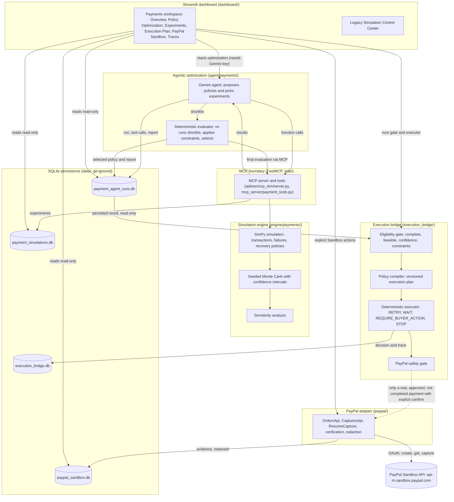

# INOEMA

**Simulate Before You Execute.**

INOEMA is infrastructure that lets AI agents evaluate the likely consequences of an operational decision *before* acting: the agent proposes a policy, a seeded simulation tests it against explicit constraints, a deterministic evaluator (not the LLM) selects, and the result is turned into an auditable execution plan.

**INOEMA Payments** is the hackathon prototype (PayPal AI Hackathon). It applies the idea to **payment recovery**: when a payment fails, should the merchant retry, wait, ask the buyer to act, or stop, and how often, how long and under which safeguards? The prototype simulates those choices, lets a Gemini agent search for a better policy through MCP tools, gates the result, compiles it into a versioned execution plan, and has a verified PayPal **Sandbox** payment lifecycle (create → buyer approval → capture → independent verification).

> **Honest status in one paragraph.** Everything in the simulation, the agent harness, the execution bridge, the PayPal Sandbox adapter and the dashboard is implemented and covered by an offline test suite (418 passing). A real USD 10.00 PayPal Sandbox payment was created, approved by a human, captured and verified. That payment was **resumed manually and is not driven by the Gemini policy**: the execution bridge is demonstrated on *simulated* payment states and is not yet connected to live PayPal recovery. The only genuine Gemini run on disk is **interrupted and LOW confidence**, so the bridge refuses it unless you use a clearly labelled demonstration override. All simulated numbers rest on assumed distributions and say nothing about PayPal production performance. See [Known limitations](#10-known-limitations-and-roadmap).

---

## Table of contents

1. [What INOEMA Payments does](#1-what-inoema-payments-does)
2. [Capabilities (and what needs credentials)](#2-capabilities-and-what-needs-credentials)
3. [Architecture](#3-architecture)
4. [Technology stack](#4-technology-stack)
5. [Repository structure](#5-repository-structure)
6. [Local setup](#6-local-setup)
7. [Running the project](#7-running-the-project)
8. [PayPal Sandbox walkthrough](#8-paypal-sandbox-walkthrough)
9. [Demonstration and evidence](#9-demonstration-and-evidence)
10. [Known limitations and roadmap](#10-known-limitations-and-roadmap)
11. [Security and data handling](#11-security-and-data-handling)
12. [Further documentation](#12-further-documentation)

---

## 1. What INOEMA Payments does

A merchant states an objective in plain language (for example: maximise recovered revenue, cap retries at 2, never retry terminal failures, require idempotency and buyer approval). INOEMA then:

1. **Simulates** failed-payment recovery with a SimPy discrete-event model under *assumed* failure distributions, for several recovery policies (immediate retry, exponential backoff, classification-aware "intelligent" recovery, no recovery, and variants).
2. **Optimizes**: a Gemini agent proposes candidate policies and chooses experiments through MCP tools. The model proposes; a **deterministic evaluator** re-runs the shortlist, applies hard constraints first, scores the rest, runs sensitivity analysis and selects.
3. **Gates and compiles**: the *execution bridge* checks that the result is complete, feasible, confident enough and within supported constraints, then compiles the selected policy into a versioned execution plan.
4. **Decides deterministically**: a policy executor maps a payment state plus a classified failure to `RETRY`, `WAIT`, `REQUIRE_BUYER_ACTION` or `STOP`, with a full trace.
5. **Validates mechanics against PayPal Sandbox**: a guarded adapter creates/retrieves orders, waits for buyer approval, captures once, and verifies the capture independently.

Every number shown in the dashboard is labelled by where it came from (see [data-source labels](#data-source-labels)).

## 2. Capabilities (and what needs credentials)

Legend: ✅ implemented and covered by offline tests · 🔑 needs credentials to run live · ⚠️ limitation.

### Payment Simulation Engine (`engine/payments/`) ✅ no credentials
- **SimPy** discrete-event simulation of transaction attempts, failures, scheduled retries, buyer actions and recovery.
- **Synthetic transaction generation** (amounts, payment methods) – no real data.
- **Failure model**: eight failure categories (`TRANSIENT_NETWORK_ERROR`, `TEMPORARY_PROCESSING_ERROR`, `INSTRUMENT_DECLINED`, `EXPIRED_PAYMENT_METHOD`, `PAYER_ACTION_REQUIRED`, `ORDER_NOT_APPROVED`, `VALIDATION_ERROR`, `TERMINAL_PAYMENT_FAILURE`), each mapped to a recovery class (auto-retry, buyer-action, terminal) and drawn from configurable, **assumed** distributions.
- **Recovery policies** (`recovery_policy.py`): retry limit, fixed or exponential backoff, maximum recovery window, buyer-action request and timeout, alternate-funding request, terminal-failure handling (abandon or flag), classification awareness, idempotent retries. Pure, deterministic `next_action`.
- **Monte Carlo**: seeded (`SeedSequence.spawn`), reproducible, common random numbers across policies, Wilson 95% confidence intervals.
- **Sensitivity analysis** (`sensitivity.py`): one-at-a-time sweeps over seven assumed parameters (`network_instability`, `buyer_response_probability`, `failure_persistence`, `workload_size`, `latency_weight`, `terminal_share`, `buyer_action_share`) reporting whether the winner stays the winner. ⚠️ Ranges are illustrative; interactions between parameters are not explored.
- **Objective-based evaluation** (`engine/objectives.py`): hard constraints first, then a weighted score over recovered revenue, processing cost, recovery latency and unnecessary attempts.

### Agentic Optimization (`agent/payments/`, `mcp_server/`) 🔑 for live runs
- **Gemini integration** through the Google Gen AI SDK (`google-genai`) with function calling. A genuine run requires `GEMINI_API_KEY` and a model your key can access. ⚠️ Free-tier quota can interrupt a run (this happened to the persisted 10,000-transaction run).
- **MCP simulation tools** served by FastMCP over stdio: `create_payment_experiment`, `generate_payment_scenarios`, `run_payment_simulation`, `compare_recovery_policies`, `run_sensitivity_analysis`, `get_payment_experiment_results`, `get_payment_transaction_trace`. The agent imports nothing from `engine/`; it reaches the simulation only through MCP.
- **Candidate exploration and adaptive experiment selection**: the model chooses which tools to call and proposes policy variations within a work-unit budget, turn limit and tool-call limit.
- **Deterministic evaluation independent of the LLM**: the final shortlist is re-run by the harness (`evaluator.py`); selection is deterministic. The harness, not the model, creates experiments.
- **Provenance**: every run persists its tool calls, events, candidates, request/served-model information and a decision report (selected policy, rejected alternatives, confidence split into repeatability / statistical uncertainty / assumption sensitivity / scenario robustness, assumptions and limitations).
- A `--scripted` test double exists for offline pipeline demos. It is **never** labelled or counted as Gemini, and the execution bridge refuses it.

### Execution Bridge (`execution_bridge/`) ✅ offline, no credentials
- **Eligibility gate** (`plan.py`): a persisted result is accepted only if the run is **complete** (genuine Gemini run finished by the model itself), a final report exists, the selected policy is **feasible** in the final deterministic evaluation, **confidence is HIGH or MEDIUM**, every objective constraint is one of the five supported ones (`max_retries`, `max_recovery_window_minutes`, `forbid_terminal_retries`, `require_idempotency`, `require_buyer_approval`) and the policy satisfies them.
- **Versioned plan compilation** (`inoema-execution-plan/1`): retry limit, per-retry delays, recovery window, buyer-action requirement and timeout, per-category rules, constraints, source run ID, policy hash and a deterministic plan ID.
- **Deterministic executor** (`executor.py`): `decide(payment_state, failure_event)` → `RETRY`, `WAIT`, `REQUIRE_BUYER_ACTION` or `STOP`, each with the rule that fired and a rationale. Safeguards: a completed/captured payment is never retried or re-captured; terminal failures are never retried; retries are blocked without an idempotency key; retry budget and recovery window are enforced; a pending buyer action waits until its timeout, then stops.
- **PayPal safety gate** (`paypal_gate.py`): simulated and read-only states never reach PayPal; completed payments never; `WAIT`/`REQUIRE_BUYER_ACTION` are read-only; a `RETRY` can only call an *injected* resume callable for a real, approved Sandbox payment with explicit confirmation.
- **Provenance and trace persistence**: every trace line carries source run ID, policy name and hash, plan ID/version, rule and rationale. `--persist` stores plans and decisions in a separate `data/execution_bridge.db`.
- **Demonstration override**: because the only genuine run is interrupted and LOW confidence, the gate refuses it by default. An explicit override (dashboard checkbox or `--allow-incomplete-source`) waives **only** the completeness and confidence checks (never feasibility or constraints), and the plan is labelled `OVERRIDDEN_INCOMPLETE_SOURCE` with warnings. **The override exists to demonstrate the mechanism. It is not production approval and must not be read as a validated policy.**
- ⚠️ The bridge is demonstrated on **simulated** payment states whose failure events are supplied by hand (`execution_bridge/scenarios.py`). It does not yet drive live PayPal recovery.

### PayPal Sandbox Integration (`paypal/`) 🔑 for live use
- OAuth client-credentials authentication; tokens are held in memory only.
- Orders v2 **create** and **retrieve**; buyer **approval** is a manual human step; **capture** only after PayPal reports `APPROVED`.
- **Independent verification**: success is declared only after a fresh GET of the order and a GET of the capture match the expected ID, reference/invoice, amount, currency and intent.
- **Idempotency**: stable `PayPal-Request-Id` values; after any ambiguous outcome the order is re-fetched before any further write.
- **Sandbox-only safeguards**: only `api-m.sandbox.paypal.com` / `api.sandbox.paypal.com` are accepted; a non-sandbox `PAYPAL_ENV` is refused; redirects are not followed; amounts are capped.
- **Evidence persistence and redaction**: every API exchange, execution and state transition is stored in SQLite (`data/paypal_sandbox.db`) with credentials, tokens and sensitive headers redacted.
- **Verified result**: **a USD 10.00 Sandbox payment lifecycle (create → buyer approval → capture → verification) was completed and verified** with the guarded `resume-capture` workflow. Sandbox funds are not real money. It proves the integration mechanics, not recovery performance.

### Dashboard (`dashboard/`) ✅ offline for persisted data
Streamlit app, opening on the **INOEMA Payments** workspace. Six sections:

| Section | Purpose | Primary data source |
|---|---|---|
| **Overview** | What it does, pipeline diagram, five-step workflow status, component status, headline metrics (three separate source-labelled groups) | mixed, each group labelled |
| **Policy Optimization** | Start a live Gemini optimization (needs credentials), or read the persisted decision report | AGENT_DERIVED |
| **Experiments** | Policy comparison tables, revenue/latency chart, sensitivity, CSV export | SIMULATED |
| **PayPal Sandbox** | Create an order, approve (manual), capture, and read evidence/transitions/API calls | SANDBOX_ACTUAL |
| **Agent Execution Traces** | Step-by-step record of what Gemini decided and which MCP tools ran (redacted) | AGENT_DERIVED |
| **Execution Plan** | Eligibility gate, compiled plan, deterministic decision trace, and the real payment shown as protected from retry | AGENT_DERIVED (gate/plan) + SIMULATED (trace) + SANDBOX_ACTUAL (real payment block) |

A sidebar **Demonstration mode** toggle loads persisted, genuine history only and disables live agent/Sandbox actions; it never substitutes a scripted model. When no *complete* genuine run exists it opens on the latest genuine run clearly labelled INTERRUPTED / INCOMPLETE.

The original **Simulation Control Center** (agent proposal → Monte Carlo → adjustment → mocked execution → independent verification, with its own mocked PayPal-style labels) is preserved unchanged: sidebar → *Workspace* → *Simulation Control Center*, or open `?workspace=simulation`, or set `INOEMA_DEFAULT_WORKSPACE=simulation`.

#### Data-source labels

Metrics are never mixed within a group, and each has its own colour *and* symbol:

| Label | Meaning |
|---|---|
| **SIMULATED** (◆) | Output of the INOEMA simulation under assumed distributions. Not PayPal data; not real-world performance. |
| **AGENT_DERIVED** (✦) | Chosen or explained by the Gemini agent and deterministic evaluator, from simulated results. |
| **SANDBOX_ACTUAL** (●) | Observed from real PayPal Sandbox API calls. Single observations, never blended with simulation. |
| **SYSTEM** (○) | Live status of a local component (not a payment metric). |

## 3. Architecture



**Boundaries to keep in mind**

- The LLM never touches `engine/`. It reaches the simulation only through MCP tools, and the **deterministic evaluator** (not the LLM) makes the selection.
- The dashboard reads the SQLite stores read-only. Its write paths are explicit user actions: start an optimization (Gemini) or create/capture a Sandbox order (PayPal).
- The **execution bridge reads a persisted result and never calls Gemini, MCP or PayPal itself.** The dotted edge to the PayPal adapter exists only as a *refusal-first gate* that needs a real, approved, not-completed Sandbox payment, an explicit confirmation and an injected callable. **No such real call is made by the demonstrations.**
- **The verified real Sandbox payment was created and then captured through the guarded `resume-capture` workflow by an operator, independently of the Gemini optimization policy and of the execution bridge.** The bridge's trace for that payment is read-only and says `NEVER_RECAPTURE`.
- The simulation never "learns" from PayPal results, and Sandbox observations are never blended into simulated rates.

## 4. Technology stack

Verified against `requirements.txt` and the imports in the source:

| Area | Technology |
|---|---|
| Language | Python (≥ 3.12 is required by the pinned NumPy; developed and tested on 3.14.7) |
| Simulation | [SimPy](https://simpy.readthedocs.io/) 4.1.2, NumPy 2.5.4 |
| Agent / LLM | Google Gen AI SDK `google-genai` (Gemini function calling) |
| Tool protocol | [FastMCP](https://gofastmcp.com/) (MCP over stdio) |
| Dashboard | Streamlit, Plotly, pandas 3.1.0 |
| PayPal | PayPal REST APIs (OAuth 2.0, Orders v2, Payments v2 captures) through `httpx` |
| Persistence | SQLite (Python standard library) |
| Tests | pytest (Streamlit `AppTest` for headless UI tests; `httpx.MockTransport` for offline PayPal tests) |

Notes: `anthropic` appears in `requirements.txt` but is used only by the Phase 1 feasibility spike in `spikes/llm_agent/`; the Payments product does not use it. `streamlit`, `plotly`, `fastmcp`, `pytest`, `httpx` and `google-genai` are unpinned in `requirements.txt`; the versions the project was developed on were Streamlit 1.66.1, Plotly 7.1.0, FastMCP 4.1.8, google-genai 3.1.0, httpx 0.28.1 and pytest 9.2.0.

## 5. Repository structure

```
.
├── engine/             Simulation core
│   ├── payments/       Payment-recovery simulation: SimPy simulator, failure model, recovery policies,
│   │                   transaction generator, metrics, scenarios, sensitivity analysis
│   ├── model.py, montecarlo.py, rules.py   Original (legacy) batch-release simulation and decision rules
│   └── objectives.py   Objective scoring: hard constraints first, then weighted score
├── agent/
│   ├── payments/       Gemini agent harness: planner, LLM backend, MCP tool adapter, candidate optimizer,
│   │                   deterministic evaluator, decision report, scripted test double
│   └── demo_agent.py   Legacy mock agent used by the Simulation Control Center
├── mcp_server/         MCP tool definitions for the payment simulation (payment_tools.py)
├── execution_bridge/   Eligibility gate, plan compiler, deterministic executor, PayPal safety gate,
│                       simulated scenarios, trace store
├── paypal/             PayPal Sandbox adapter: client, auth, orders, capture, resume-capture workflow,
│                       error classifier, recovery executor, negative testing, evidence persistence
├── storage/            SQLite stores for simulation experiments and agent runs (plus legacy store)
├── dashboard/
│   ├── app.py          Entry point; workspace switch (Payments default, legacy preserved)
│   └── payments/       Payments workspace: six page modules, data access (read-only), charts, redaction
├── scripts/            Runnable entry points (dashboard launcher, demos, PayPal validation CLI, browser review)
├── tests/              Offline test suite; tests/integration/ holds the optional LIVE tests
├── docs/               Design and evidence documents (see section 12) and docs/screenshots/
├── spikes/             Phase 1 feasibility spikes. NOTE: spikes/mcp_sim/server.py is the FastMCP server
│                       entry point the agent and dashboard actually launch (module spikes.mcp_sim.server)
├── collector/, execution/, pipeline.py   Legacy pipeline: independent reality simulator, collector, mocked payout
├── .streamlit/         Streamlit theme and telemetry settings
├── requirements.txt    Python dependencies
└── .env.example        Environment variable template (placeholders only)
```

`data/` (created at runtime, git-ignored) holds the SQLite databases.

## 6. Local setup

### Prerequisites

- **Git**
- **Python 3.12 or newer.** No minimum is declared in the repository (there is no `pyproject.toml`); 3.12 is implied by the pinned `numpy==2.5.4`, and the project was developed and tested on **3.14.7**.
- *Optional* – a **Gemini API key** ([Google AI Studio](https://aistudio.google.com/apikey)) for live optimization.
- *Optional* – a **PayPal Developer account** with Sandbox accounts, for the PayPal integration.

You do **not** need either key to explore the product, run the simulation, run the execution bridge, run the dashboard on persisted data, or run the offline tests.

### Clone and install

```bash
git clone https://github.com/RaHuL-SrIrAM-E/INOEMA.git
cd INOEMA

# macOS / Linux
python3 -m venv .venv
source .venv/bin/activate

# Windows (PowerShell) - instructions only; this project was developed and tested on macOS
#   py -3 -m venv .venv
#   .venv\Scripts\Activate.ps1

pip install -r requirements.txt
```

Commands below use `python`; with the virtual environment active that is `.venv/bin/python`. Without activation, call `.venv/bin/python` explicitly.

### Configuration

```bash
cp .env.example .env        # Windows: copy .env.example .env
chmod 600 .env              # macOS/Linux: owner-only
```

`.env` is **git-ignored**. It is read by a tiny loader (`spikes/envutil.py`) that the launcher `scripts/run_payments_dashboard.py`, the PayPal and Gemini scripts, and the live tests call at start. **A plain `streamlit run dashboard/app.py` does not load `.env`**, so start the Payments dashboard with the launcher if you want it to see your credentials. **Variables already exported in your shell win over `.env`** (the loader never overrides them), so an old `export PAYPAL_CLIENT_ID=...` in your shell will silently shadow the file.

Only variables the code actually reads are listed (all values below are placeholders):

| Variable | Needed for | Default / behaviour |
|---|---|---|
| `GEMINI_API_KEY` | Live optimization (Gemini) | none; `GOOGLE_API_KEY` is accepted as a fallback. Without a key the live agent refuses to start |
| `GEMINI_MODEL` | Live optimization | code default is `gemini-2.5-flash` (`agent/payments/models.py`), which may not be available to your key. **Set this to a model your key can access** (the persisted run used `gemini-3.5-flash`). The agent never silently falls back to another model |
| `PAYPAL_CLIENT_ID`, `PAYPAL_CLIENT_SECRET` | Any PayPal Sandbox call | none; **Sandbox** REST app credentials |
| `PAYPAL_ENV` | optional | must be `sandbox` (or unset); anything else is refused. `PAYPAL_MODE` / `PAYPAL_ENVIRONMENT` are checked the same way |
| `PAYPAL_BASE_URL` | optional | default `https://api-m.sandbox.paypal.com`; any non-Sandbox host is refused |
| `INOEMA_ALLOW_LIVE_PAYPAL` | optional | set to `1` to let the live PayPal tests run (see [Running](#7-running-the-project)) |
| `INOEMA_ALLOW_LIVE_GEMINI` | optional | set to `1` to let the live Gemini tests run; a key alone is not enough (see [Running](#7-running-the-project)) |
| `INOEMA_PAYMENT_DB`, `INOEMA_AGENT_DB`, `INOEMA_PAYPAL_DB`, `INOEMA_BRIDGE_DB` | optional | database paths; defaults under `data/` (`payment_simulations.db`, `payment_agent_runs.db`, `paypal_sandbox.db`, `execution_bridge.db`) |
| `INOEMA_DEFAULT_WORKSPACE` | optional | `payments` (default) or `simulation` to open the legacy app |
| `INOEMA_DEMO_MODE` | optional | `1` starts the dashboard in Demonstration mode |
| `INOEMA_DASHBOARD_AUTOCHECK` | optional | `0` skips the automatic MCP-server check on the Overview page |
| `INOEMA_MCP_SERVER_MODULE` | optional | override the MCP server module (default `spikes.mcp_sim.server`) |
| `ANTHROPIC_API_KEY`, `SPIKE_LLM_MODEL` | Phase 1 spike only | not used by the Payments product |
| `CHROME_BIN` | `scripts/browser_review.py` only | optional path to a Chromium for screenshots |

Example `.env` (placeholders only):

```dotenv
GEMINI_API_KEY=<your-gemini-key>
GEMINI_MODEL=<a-model-your-key-can-access>
PAYPAL_CLIENT_ID=<sandbox-client-id>
PAYPAL_CLIENT_SECRET=<sandbox-client-secret>
PAYPAL_ENV=sandbox
PAYPAL_BASE_URL=https://api-m.sandbox.paypal.com
```

## 7. Running the project

Commands are grouped by what they touch. Run everything from the repository root.

### A. Safe and offline (no external API calls, no Sandbox resources)

| # | Goal | Command |
|---|---|---|
| 1 | Start the default dashboard (Payments workspace) | `python -m scripts.run_payments_dashboard` then open http://localhost:8501 |
| 2 | Start in **Demonstration mode** (persisted history, live actions disabled) | `python -m scripts.run_payments_dashboard --demo` (add `--port 8502` to change the port) |
| 3 | Open the **legacy Simulation Control Center** (needs no credentials) | With the dashboard running, sidebar → *Workspace* → *Simulation Control Center*, or open http://localhost:8501/?workspace=simulation . Alternatively `INOEMA_DEFAULT_WORKSPACE=simulation streamlit run dashboard/app.py` (the launcher script always starts in Payments) |
| 4 | Payment simulation demo (drives the MCP tools through an independent MCP client; SIMULATED data) | `python -m scripts.payment_sim_demo [--db PATH]` |
| 5 | Sensitivity analysis | Runs inside every agent run, and is available as the `run_sensitivity_analysis` MCP tool. The offline way to see it end to end is the scripted pipeline below, which prints the sensitivity findings and confidence. There is no standalone sensitivity CLI |
| 6 | Execution bridge demonstration | `python -m scripts.execution_bridge_demo` (gates the latest genuine run; refuses an interrupted or low-confidence run and exits with status 1) |
| 6b | … with the **demonstration override** | `python -m scripts.execution_bridge_demo --allow-incomplete-source` (labelled `OVERRIDDEN_INCOMPLETE_SOURCE`; not production approval) |
| 7 | Persist bridge plans and traces | `python -m scripts.execution_bridge_demo --allow-incomplete-source --persist [--bridge-db PATH]` (writes only `data/execution_bridge.db`) |
| 8 | Offline tests | `python -m pytest -q --ignore=tests/integration` |

Scripted pipeline demo (uses a **test double, not Gemini**; no API call). It **writes** a run into the agent and simulation databases, so redirect them if you want to keep `data/` clean:

```bash
INOEMA_PAYMENT_DB=/tmp/sim.db INOEMA_AGENT_DB=/tmp/agent.db python -m scripts.payment_agent_demo --scripted
```

The execution bridge refuses scripted runs: only genuine Gemini runs can be complete.

### B. Commands that call external services (credentials required)

| # | Goal | Command | Effect |
|---|---|---|---|
| 9 | Genuine Gemini optimization | `python -m scripts.payment_agent_demo` (options: `--model`, `--max-iterations`, `--trials`, `--final-trials`, `--json-out`) | Calls the Gemini API (spends quota); runs the simulation locally through MCP; persists the run |
| 9b | Optional live Gemini tests | `INOEMA_ALLOW_LIVE_GEMINI=1 python -m pytest tests/integration -m gemini_live -v -s` | Calls Gemini (spends quota); needs `GEMINI_API_KEY` as well |
| 10 | Optional live PayPal Sandbox tests | `INOEMA_ALLOW_LIVE_PAYPAL=1 python -m pytest tests/integration -m paypal_live -v -s` | **Creates real Sandbox orders** and attempts a real capture that PayPal is expected to reject. Evidence goes to throw-away temp databases |

**Avoid accidental test orders and quota use**

- The live PayPal tests run only if `INOEMA_ALLOW_LIVE_PAYPAL=1` *and* Sandbox credentials are present; credentials alone do not enable them. A test enforces this.
- The live **Gemini** tests are opt-in in the same way: they run only if `INOEMA_ALLOW_LIVE_GEMINI=1` *and* a Gemini key are present. A key in `.env` or the environment alone does not enable them, and a test enforces this. A plain `python -m pytest` therefore never calls Gemini or creates Sandbox orders.
- Unset or leave empty any credential you do not want a command to use.

## 8. PayPal Sandbox walkthrough

Sandbox transactions use PayPal's test environment and **do not move real money**. Never use real PayPal accounts or Live credentials with this project; the code refuses non-Sandbox hosts.

1. **Create a Sandbox Business account** in the PayPal Developer Dashboard (its Sandbox accounts section; menu names may change). Choose the country you want to test with (the integration allows USD, EUR, GBP, CAD and AUD; the demonstration used a **US** merchant and USD).
2. **Create a REST API app** (Apps & Credentials → Sandbox) linked to that Business account. Copy its **Client ID** and **Secret**.
3. **Create a Sandbox Personal (buyer) account** in the same Sandbox environment. This is the account a human uses to approve the payment.
4. **Configure credentials**: put the Client ID/Secret in `.env` (see [Configuration](#configuration)) with `PAYPAL_ENV=sandbox` and `PAYPAL_BASE_URL=https://api-m.sandbox.paypal.com`. Do not paste secrets into chats, issues or commits.
5. **Verify OAuth** (no order is created):
   ```bash
   python -m scripts.paypal_sandbox_validation check
   ```
   Expected: `OAuth OK against https://api-m.sandbox.paypal.com (token not shown).` The call is recorded (redacted) in `data/paypal_sandbox.db`.
6. **Create an order** with a unique reference. This creates one real Sandbox order and **stops at buyer approval; it never captures an unapproved order**. It prints the approval URL:
   ```bash
   python -m scripts.paypal_sandbox_validation run --reference MY-DEMO-001 --amount 10.00 --currency USD --demo-policy
   ```
   (`--demo-policy` uses a built-in example policy, clearly labelled as not agent-selected. You can also create the order from the dashboard's **PayPal Sandbox** section.)
7. **Approve it as the buyer**: open the printed approval URL in a browser, log in with the Sandbox **Personal** account and approve. INOEMA never automates this step.
8. **Check state and capture with the guarded command** (note the order ID printed in step 6). Without `--confirm-capture` it only checks and refuses to capture:
   ```bash
   # check only: fresh GET, identity checks; refuses unless PayPal reports APPROVED
   python -m scripts.paypal_sandbox_validation resume-capture \
     --order-id <ORDER_ID> --reference MY-DEMO-001 --amount 10.00 --currency USD

   # capture, explicitly confirmed (one capture request with a stable idempotency key)
   python -m scripts.paypal_sandbox_validation resume-capture \
     --order-id <ORDER_ID> --reference MY-DEMO-001 --amount 10.00 --currency USD --confirm-capture
   ```
   The command refuses on any mismatch of order ID, reference/invoice, amount, currency or intent; refuses if the order is not `APPROVED`; never captures a completed order; and after an ambiguous response re-fetches the order before anything else.
9. **Verify**: a successful run reports `CAPTURED_AND_VERIFIED` after a fresh order GET and a capture GET agree. Inspect the evidence in the **PayPal Sandbox** dashboard section, or:
   ```bash
   python -m scripts.paypal_sandbox_validation evidence --reference MY-DEMO-001 --experiment-id manual-resume-capture
   ```

Exit code is 0 only for `CAPTURED_AND_VERIFIED` / `ALREADY_CAPTURED_VERIFIED`. See `docs/PAYPAL_SANDBOX_INTEGRATION.md` §14 for every outcome.

## 9. Demonstration and evidence

A suggested walkthrough (run `python -m scripts.run_payments_dashboard --demo`):

1. **Product overview** – the **Overview** section: what INOEMA Payments does, the pipeline diagram, the five-step workflow and the three separately labelled metric groups.
2. **Simulation and policy comparison** – **Experiments**: compare policies (recovery rate with 95% CI, recovered revenue, latency, retries, processing cost, feasibility). All ◆ SIMULATED.
3. **Gemini agent and MCP traces** – **Policy Optimization** (decision report: selected policy, rejected alternatives, confidence breakdown) and **Agent Execution Traces** (each Gemini turn and MCP tool call). Say plainly that the persisted run is **interrupted** and its confidence is **LOW**.
4. **Eligibility gate and execution bridge** – **Execution Plan**: the gate refuses the interrupted, LOW-confidence run and shows which checks failed.
5. **Demonstration override (with the warning)** – tick the override. The page shows the override warning, the compiled plan for the real selected policy, and a deterministic decision trace over nine **simulated** payment states that exercises `RETRY`, `WAIT`, `REQUIRE_BUYER_ACTION` and `STOP`. **This is a demonstration of the mechanism, not an approved policy and not an outcome PayPal produced.**
6. **Actual PayPal Sandbox evidence** – **PayPal Sandbox**: the verified USD 10.00 execution: its state transitions, the API calls with PayPal debug IDs, a single `CAPTURE_ORDER`, and "Capture verified: Yes". **This payment was created and captured manually with `resume-capture`, independently of the Gemini policy and of the execution bridge.** The Execution Plan page shows the same payment only as a read-only "never re-capture" check.

Offline test suite, re-run for this README: **`python -m pytest -q --ignore=tests/integration` → 418 passed.** (Including the optional live tests, which are skipped without credentials and opt-in, a default `pytest` run reports 418 passed and 7 skipped. A skip is not a pass: the live Gemini and live PayPal paths are exercised only when you deliberately run them.) The mocked PayPal in the tests encodes our assumptions and is not evidence of Sandbox behaviour; the real evidence is the persisted Sandbox run.

## 10. Known limitations and roadmap

### Known limitations

- **The genuine Gemini run on disk is interrupted and LOW confidence.** The persisted 10,000-transaction run ended with `llm_error` (quota exhausted mid-run). Its selected policy is real but the run is not complete; its confidence label is LOW (not separable from the runner-up, fragile under sensitivity sweeps).
- **The execution bridge refuses it by default.** Only the explicit demonstration override produces a plan, labelled `OVERRIDDEN_INCOMPLETE_SOURCE`.
- **The demonstration override is not production approval.** It waives only completeness and confidence, never feasibility or constraints.
- **Policy decisions are not connected end-to-end to live PayPal recovery.** The verified Sandbox payment was resumed manually.
- **Execution-bridge failure scenarios are manually supplied** simulated inputs, not events from live PayPal failures.
- **Buyer notification and review routing are not implemented.** The plan can *require* buyer action and *flag* terminal failures for review; INOEMA does not send notifications or route reviews.
- **Simulated outcomes are assumption-dependent.** Failure rates, category mixes, persistence, buyer response and costs are assumptions, not empirical statistics, and are **not PayPal production performance**. Confidence intervals quantify simulation sampling error only.
- **Sandbox verification does not prove production performance.** It validates mechanics (auth, order, approval, capture, idempotency, verification), and the Sandbox may not exhibit real issuer, decline or latency behaviour.
- Further: the Sandbox-error classification table is partly documented and partly modelling assumption; negative-testing mock codes are not verified per endpoint; the dashboard was visually reviewed on one desktop width and one headless Chromium build only; the `GEMINI_MODEL` code default may not be available to your key; Windows setup is untested.

### Roadmap (not implemented)

- Obtain a complete, MEDIUM-or-better genuine Gemini run so the bridge can compile an un-overridden plan.
- Drive live Sandbox failure and recovery events through the executor (using the existing guarded adapter), including Sandbox negative-testing responses.
- Buyer notification and human-review routing.
- Calibrating the failure model against merchant-supplied data, if available.
- Packaging (`pyproject.toml`, declared Python range) and CI.
- Broader browser/viewport checks for the dashboard.

## 11. Security and data handling

- **Never commit `.env`.** It is git-ignored; keep it `chmod 600`. Use separate credentials for any production system: this project is Sandbox-only and has no Live mode.
- **Sandbox-only enforcement**: non-Sandbox `PAYPAL_ENV`, base URL or host is refused, redirects are not followed, and every persisted row is pinned to the `PAYPAL_SANDBOX` environment.
- **Secrets and tokens are redacted** from logs, persisted API evidence and the dashboard: the client ID/secret, Authorization headers and access tokens are replaced with `***REDACTED***`; agent tool I/O is sanitized and truncated. OAuth tokens live in memory only.
- **Local SQLite files hold private evidence.** `data/*.db` (and any `*.db`) are git-ignored. Stored PayPal responses can include the Sandbox buyer's name, email and address, because redaction targets secrets, not buyer details. The dashboard does not display buyer details. Treat the databases as private.
- **Never upload or share** `data/paypal_sandbox.db` or the other databases, or paste raw rows into issues or screenshots. Do not open the raw rows on screen during a demo.
- **Do not paste credentials into chats, tickets or commits.** If a secret was exposed, rotate it in the PayPal or Google console.
- **Test hygiene**: the live PayPal tests are opt-in and write evidence to temp databases; the offline tests use mocks and temp databases and make no network calls.
- **Scripted and mocked components are always labelled** and never counted as genuine Gemini or PayPal evidence.

**`.gitignore`.** Ignored: `.env` and every `.env.*` variant (except the tracked template `.env.example`), `.streamlit/secrets.toml`, all `*.db` files plus SQLite sidecars (`*.db-wal`, `*.db-shm`, `*.db-journal`, `*.sqlite*`), Python caches and virtual environments, `*.jsonl`, `*.log` and `.DS_Store`. Documentation, source and configuration such as `.streamlit/config.toml` are deliberately **not** ignored.

`docs/screenshots/` is tracked; those screenshots were generated before any real Sandbox activity existed, but re-check any new screenshots for order IDs or buyer details before committing.

## 12. Further documentation

| Document | Contents |
|---|---|
| [`docs/PAYMENT_SIMULATION_MODEL.md`](docs/PAYMENT_SIMULATION_MODEL.md) | Simulation model, assumptions, failure categories, objective scoring |
| [`docs/AUTONOMOUS_PAYMENT_AGENT.md`](docs/AUTONOMOUS_PAYMENT_AGENT.md) | Agent design, MCP tools, evaluator, confidence |
| [`docs/LIVE_GEMINI_VALIDATION.md`](docs/LIVE_GEMINI_VALIDATION.md) | Evidence from live Gemini runs and the errors encountered |
| [`docs/PAYPAL_SANDBOX_INTEGRATION.md`](docs/PAYPAL_SANDBOX_INTEGRATION.md) | PayPal adapter, safety rules, verified vs unverified behaviour, resume-and-capture workflow |
| [`docs/EXECUTION_BRIDGE.md`](docs/EXECUTION_BRIDGE.md) | Eligibility gate, plan compilation, executor, current status and gaps |
| [`docs/DASHBOARD.md`](docs/DASHBOARD.md) | Dashboard design and data-source labelling |
| [`docs/FINAL_DASHBOARD_REVIEW.md`](docs/FINAL_DASHBOARD_REVIEW.md) | Browser review evidence and remaining UI issues |
| [`docs/PAYMENTS_CODEBASE_AUDIT.md`](docs/PAYMENTS_CODEBASE_AUDIT.md), [`docs/PHASE1_SPIKE_RESULTS.md`](docs/PHASE1_SPIKE_RESULTS.md) | Initial audit and feasibility spikes |

There is no `LICENSE` file in the repository, so no license is stated here; add one before distributing.
